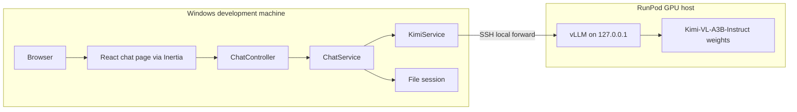
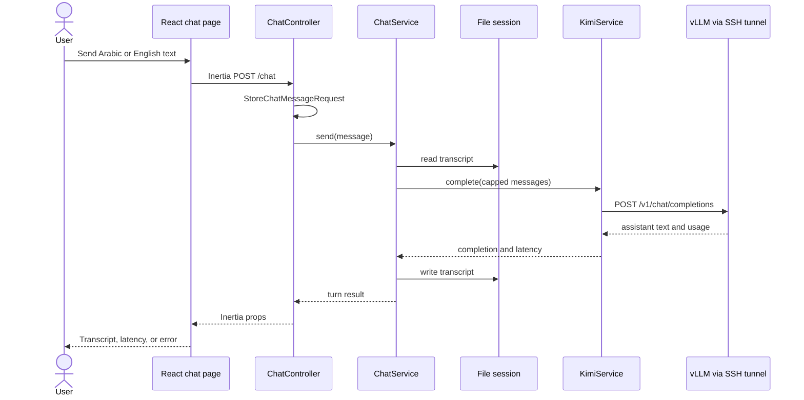
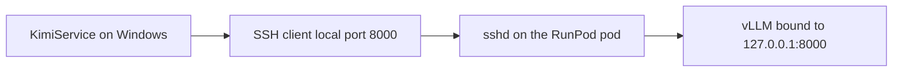
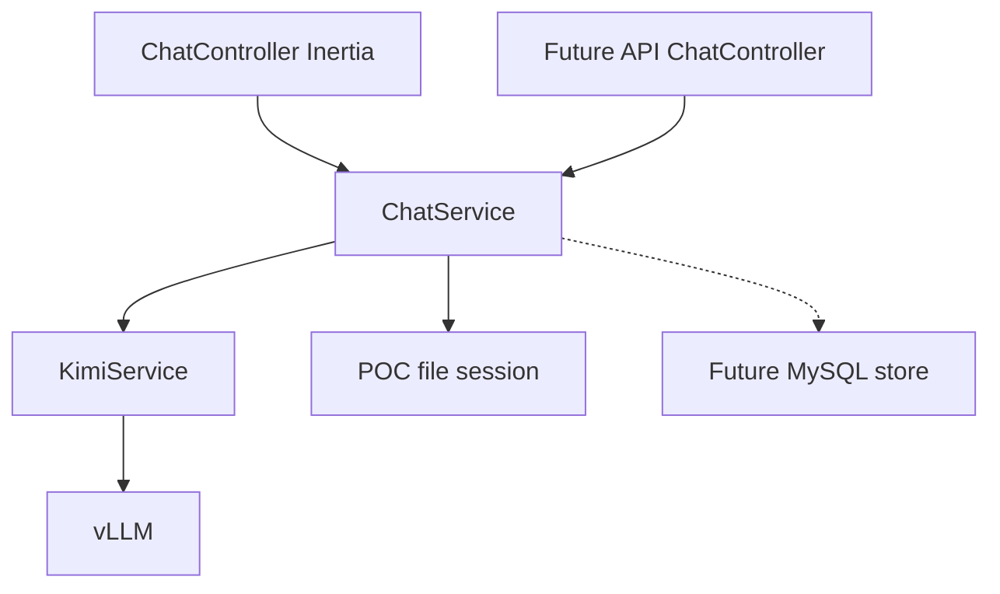

# Architecture

Status: application implemented on 22 October 2026. The chat UI and services exist. Tests fake RunPod. The Laravel process has not called the live endpoint.

The sections below remain the original Phase 1 design, including the SSH tunnel. The implemented inference path is the RunPod queue, not that tunnel. The Pod files stay in the repository as the unused fallback.

## Implemented inference path

```text
Browser
  -> Inertia React page
    -> Laravel POST /chat
      -> ChatService
        -> KimiService
          -> POST https://api.runpod.ai/v2/{endpoint_id}/run
          -> GET  https://api.runpod.ai/v2/{endpoint_id}/status/{job_id}
          -> POST https://api.runpod.ai/v2/{endpoint_id}/cancel/{job_id}
            -> worker
              -> vLLM on 127.0.0.1 inside the worker
```

`KimiService` is the only class that calls RunPod. The body is `input.openai_route = /v1/chat/completions` and `input.openai_input` for the chat completion. `stream` is false. The API key and endpoint id come from configuration and are not Inertia props.

The browser does not wait on one PHP request for the whole cold start. `POST /chat` only submits the job. The page then posts to `POST /chat/poll` about every 2 seconds. Each poll makes one status request. The 1020 second budget is enforced from the submit time across those polls. At the budget, or when the user cancels or clears, Laravel calls `/cancel` once and does not submit another job. A `startup_error` blocks further submits until the chat is cleared.

Closing the browser does not cancel a running worker. The next poll after the budget does. The page says so while a reply is in progress.

This path uses RunPod's authenticated queue. It does not satisfy the original NFR-6 SSH-tunnel requirement. That requirement still describes the Pod fallback. Using the queue was an explicit implementation request after the operator reported a completed smoke test on endpoint `f6icz11anfucte`. A completed job is not, by itself, proof that the pinned revision was loaded.

## Unified Laravel and React application

The browser loads one Laravel origin. Inertia serves the React chat page from that origin. Vite compiles JSX into assets that Laravel’s Blade root view loads. Controllers, services, session storage, and the HTTP call to vLLM all live in the same PHP application.

There is no `frontend/` project, no `backend/` project, and no Express process. A `routes/api.php` file may exist because the Laravel skeleton ships one. The POC does not register product API routes and does not authenticate them.



## Request and response flow

A successful turn:

1. The React page posts the message with Inertia, including the CSRF token.
2. `StoreChatMessageRequest` validates `message` as a required string of 1 to 4,000 characters.
3. `ChatController` calls `ChatService::send()`.
4. `ChatService` reads the session transcript, appends the user turn, and passes the capped transcript to `KimiService::complete()`.
5. `KimiService` sends `POST {KIMI_BASE_URL}/chat/completions` with the configured model id and a timeout.
6. On success, `ChatService` appends the assistant turn, stores the transcript, and returns the transcript plus latency.
7. The controller returns an Inertia response. The page renders the new turn and the latency.

A failed turn:

1. Connection failure, a non-success HTTP status, malformed JSON, empty assistant content, or a timeout becomes a dedicated inference exception inside `KimiService`.
2. `ChatService` does not append an assistant turn.
3. The user message remains in the transcript so the user sees what they sent, and the error is shown separately. If the same text is submitted again before a later success, `ChatService` reuses that pending user turn so the transcript does not gain a duplicate. Phase 7 implements this rule explicitly.
4. The page shows the error state. Validation failures stay on the form and never call vLLM.



The vLLM path is the OpenAI-compatible server documented by Moonshot for this checkpoint. **Observed** on 21 October 2026 in the [Kimi-VL deployment section](https://github.com/MoonshotAI/Kimi-VL/blob/main/README.md): `vllm serve` exposes a local `/v1` API, and the Instruct example uses the served model name `kimi-vl`. The POC treats that name as configuration (`KIMI_MODEL`), not as a constant buried in PHP.

The upstream example also sets `--max-model-len 32768`. That value is an upstream illustration for a long context. It is not the POC setting. The POC server flag is chosen after the Phase 2 memory estimate and is expected to be much shorter.

## Laravel controllers and services

### `App\Http\Controllers\ChatController`

Responsibilities:

- Render the chat page on `GET /`.
- Accept `POST /chat`.
- Accept `POST /chat/clear`.
- Map a service result to Inertia props.

It does not assemble the vLLM payload and it does not read or write the session transcript itself.

### `App\Http\Requests\StoreChatMessageRequest`

Responsibilities:

- Authorize the request by returning true. The POC has no users.
- Validate `message`.
- Reject non-string values and values outside 1 to 4,000 characters.

### `App\Services\ChatService`

Responsibilities:

- Own the session key `chat.transcript`.
- Append, list, and clear turns.
- Cap the messages forwarded to inference.
- Call `KimiService`.
- Pass through the latency measured by `KimiService`.
- Return a plain result object the controller can serialize. A later API controller can serialize the same object as JSON.

Planned operations:

- `transcript(): array`
- `send(string $message): ChatTurnResult`
- `clear(): void`

`ChatService` depends on the session store and `KimiService`. It does not depend on Inertia or on an HTTP client.

### `App\Services\KimiService`

Responsibilities:

- Read `config/kimi.php`.
- Build the chat-completions JSON body: `model`, `messages`, `temperature`, `max_tokens`.
- Call the base URL with Laravel’s HTTP client.
- Map transport and upstream failures to one application exception.
- Return assistant text, latency in milliseconds, and token usage when vLLM includes a `usage` object.

Planned operation:

- `complete(array $messages): KimiCompletion`

The Instruct checkpoint’s published sampling note is temperature 0.2. **Observed** in the Kimi-VL README. The POC default for `KIMI_TEMPERATURE` is therefore `0.2`, still overridable from the environment. Greedy sampling at temperature 0 is also described as acceptable for the Instruct model. Phase 6 records which value was used. This is a sampling default, not evidence that a GPU can load the model.

### Configuration

`config/kimi.php` reads:

| Variable | Purpose | POC default |
| --- | --- | --- |
| `KIMI_BASE_URL` | OpenAI-compatible origin, including `/v1` | `http://127.0.0.1:8000/v1` through the tunnel |
| `KIMI_MODEL` | Served model name | `kimi-vl` |
| `KIMI_API_KEY` | Optional bearer token if vLLM is started with an API key | Empty until Phase 8 decides |
| `KIMI_TIMEOUT` | Seconds | `120` |
| `KIMI_TEMPERATURE` | Instruct sampling default | `0.2` |
| `KIMI_MAX_TOKENS` | Completion cap per turn | `512` |
| `KIMI_CONTEXT_MESSAGES` | Maximum prior messages forwarded | Chosen in Phase 7 |

`.env.example` gains these keys in Phase 7. The real `.env` is never committed.

Session and cache drivers in `.env`:

- `SESSION_DRIVER=file`
- `CACHE_STORE=file`
- `QUEUE_CONNECTION=sync`

`DB_CONNECTION` may remain in the skeleton’s example file. The POC must not require a reachable database. Phase 7 keeps the application on file sessions and file cache, and it does not add migrations. If the generated skeleton refuses to boot without a database driver, that boot issue is solved without introducing MySQL and without storing chat data in a database.

## Secure connection to vLLM



Rules for the POC:

- The vLLM process binds to `127.0.0.1`, not `0.0.0.0`.
- RunPod’s public HTTP proxy, and any exposed TCP port for port 8000, stay unused.
- The developer opens an SSH local forward from Windows to the pod. Laravel’s base URL is `http://127.0.0.1:8000/v1` on the developer machine.
- SSH private keys stay outside the repository.
- If the pinned vLLM release supports an API key flag, Phase 8 enables it as a second control. The key travels only in `.env` and the SSH session that starts vLLM. Support for that flag is an **assumption** until Phase 2 confirms the pinned release.
- The pod exposure settings are recorded in the Phase 8 notes, including a check that port 8000 is not reachable from the public internet.

The custom modeling files in the official repository run on the GPU host because the checkpoint uses remote code. **Observed:** the Hugging Face config maps `AutoModel` to `modeling_kimi_vl.KimiVLForConditionalGeneration`. Phase 5 pins the commit that Phase 2 records. The commit observed on 21 October 2026 is `398eede0903cd983a2bfa0cc634e9ac1d843f375`. That pin is fetched again immediately before any download because the repository can move.

## Temporary chat context

The POC distinguishes two kinds of history:

| Kind | POC behavior |
| --- | --- |
| Temporary chat context | The file-session array under `chat.transcript`. It exists for one browser session and is sent, after capping, to vLLM. |
| Persistent conversation history | Not implemented. No conversation or message tables. |

Each stored turn:

```json
{
  "role": "user",
  "content": "text",
  "at": "2026-10-21T16:00:00+04:00"
}
```

`role` is `user` or `assistant`. A system line is added only to the outbound vLLM payload. It starts with the configured prompt, then tells the model to answer in the language of the latest user message: Arabic text is answered in Arabic, and English text in English. That line is not stored as a clearable user turn.

The file session driver means the transcript ends when the session expires or the user clears it. It is not shared across browsers. That is the intended POC behavior.

The cap on forwarded messages is an application control. The vLLM `--max-model-len` flag is the hard control on the GPU. Both are required. A request that exceeds the server limit is surfaced by `KimiService` as an inference error.

## Future REST API and MySQL expansion

The POC does not add these routes or tables. The extension points are:

- A future API chat controller calls `ChatService` and returns JSON. It does not copy inference code.
- `KimiService` stays unaware of whether the caller is Inertia or JSON.
- When persistence is added, transcript reads and writes move behind a small store used by `ChatService`. In the POC those reads and writes remain private methods on `ChatService`. Phase 7 does not add a repository interface for a single file-session implementation.
- MySQL arrives as migrations plus that store. The inference class stays as it is.

The data model and the route sketch are in [future-expansion.md](future-expansion.md).



## Proposed project structure

Phase 7 creates the Laravel skeleton in this repository root and then adds the application files below. `docs/` stays at the root. Nothing in this tree is generated in Phase 1.

```text
kimi-self-hosted-poc/
├── README.md
├── .gitignore
├── .env.example                 # skeleton, plus KIMI_* keys in Phase 7
├── artisan
├── composer.json
├── package.json
├── vite.config.js
├── docs/
│   ├── requirements.md
│   ├── architecture.md
│   ├── implementation-plan.md
│   ├── model-compatibility-checklist.md
│   └── future-expansion.md
├── app/
│   ├── Http/
│   │   ├── Controllers/
│   │   │   └── ChatController.php
│   │   └── Requests/
│   │       └── StoreChatMessageRequest.php
│   └── Services/
│       ├── ChatService.php
│       ├── KimiService.php
│       ├── ChatTurnResult.php
│       └── KimiCompletion.php
├── bootstrap/
│   └── app.php
├── config/
│   └── kimi.php
├── database/                    # skeleton only; no POC migrations
├── public/
├── resources/
│   ├── css/
│   │   └── app.css
│   ├── js/
│   │   ├── app.jsx
│   │   ├── Pages/
│   │   │   └── Chat/
│   │   │       └── Index.jsx
│   │   └── Components/
│   │       └── Chat/
│   └── views/
│       └── app.blade.php
├── routes/
│   ├── web.php                  # GET /, POST /chat, POST /chat/clear
│   └── console.php
├── storage/
│   └── framework/
│       └── sessions/            # file sessions at runtime
└── tests/
    └── Feature/
        └── ChatTest.php         # Phase 9; HTTP client faked, no GPU required
```

Operational notes for the GPU host, written in Phases 4 and 5, go under `docs/` as runbooks. They are not a second application. Model weights, virtual environments, and SSH keys never go in this tree.

### Routes

| Method and path | Handler | Result |
| --- | --- | --- |
| `GET /` | `ChatController@index` | Chat page and current transcript |
| `POST /chat` | `ChatController@store` | Validates, infers, redirects back with Inertia props |
| `POST /chat/clear` | `ChatController@clear` | Empties the session transcript |

### Frontend boundary

`resources/js/Pages/Chat/Index.jsx` is the page. It renders the transcript, the composer, the submitting state from Inertia’s form helper, the error text, the latest latency, and the clear action. Components under `resources/js/Components/Chat/` stay presentational. They do not know the vLLM URL.

The visual design is produced in Phase 7. Phase 1 does not lock a theme. The page is one chat workspace, with a clear hierarchy, readable Arabic and English text, and visible focus, disabled, loading, empty, and error states.

## Deployment view for the POC

| Process | Where it runs | Started by |
| --- | --- | --- |
| Local PHP server and Vite dev server | Windows workstation | Developer, in Phase 7 and Phase 8 |
| SSH local forward | Windows workstation | Developer, in Phase 8 |
| vLLM | RunPod pod | Developer, in Phase 5, after spend approval |

Laravel is not deployed to RunPod for the POC. The GPU host runs the model. The workstation runs the web application.

## Claims that this design depends on

| Claim | Label |
| --- | --- |
| One Laravel 13 application can host Inertia React | Decision. Standard Laravel starter path. The exact installer command is checked in Phase 7. |
| vLLM can serve this checkpoint behind `/v1/chat/completions` | Observed in upstream docs and the vLLM supported-model table. Not yet pinned to a release or booted. |
| SSH local forwarding is available on the developer PC | Assumption until Phase 8 checks the Windows OpenSSH client. |
| vLLM API-key flag exists in the pinned release | Assumption until Phase 2. |
| A rented GPU can load the checkpoint | Not claimed. See the compatibility checklist. |
